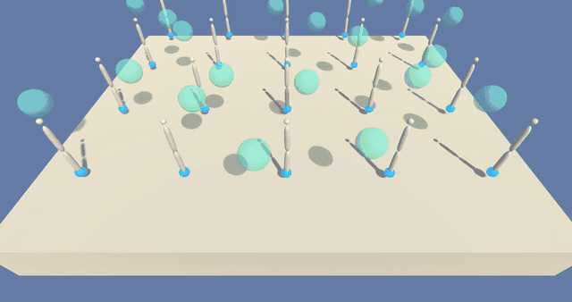

# PPO for a 4-DOF robot arm

Continuous-action PPO in Python and PyTorch for a simulated reaching task.
Generalized Advantage Estimation (GAE) and advantage normalization can be enabled
independently to compare their effect on learning.



## Results

With GAE and advantage normalization, all five seeds solve the task within 130–144
episodes and finish at a 100-episode mean of about 39.4. Details, plots and the
comparison with the other configurations are in [Report.pdf](Report.pdf). The
weights of the agent shown above are in `model_weights.pt`. They are a
`state_dict` for `ActorCritic(33, 4, hidden_size=128)` from `model.py`.

To load the submitted weights:

```python
import torch
from model import ActorCritic

model = ActorCritic(state_size=33, action_size=4, hidden_size=128)
model.load_state_dict(torch.load("model_weights.pt", map_location="cpu", weights_only=True))
model.eval()
```

## Environment

Each Unity instance contains 20 arms sharing one policy. Each arm receives 33
observations and produces four normalized torque commands in `[-1, 1]`. The reward
is `+0.1` while the hand is inside the target region. The task is considered solved
when the mean return across all arms and 100 consecutive episodes reaches 30.

## Setup

Requirements: Linux x86-64, Python 3.10, and the 20-arm Reacher Linux environment
compatible with Unity ML-Agents API 4.

From the repository root:

```bash
python3.10 -m venv .venv
source .venv/bin/activate
python -m pip install -r requirements.txt
```

Download the [20-arm Linux Reacher environment](https://s3-us-west-1.amazonaws.com/udacity-drlnd/P2/Reacher/Reacher_Linux.zip)
and extract it into `env/`, giving:

```text
env/Reacher_Linux/
    Reacher.x86_64
    Reacher_Data/
```

If necessary, make the executable runnable:

```bash
chmod +x env/Reacher_Linux/Reacher.x86_64
```

Dependencies are listed in `requirements.txt`: PyTorch for learning, NumPy for
rollout storage, Matplotlib for plots, Pillow for the Unity client, and pinned
protobuf/gRPC versions for simulator communication. The compatible legacy client
is bundled in `vendor/`; a current `mlagents_envs` package is not a replacement.
Third-party licenses are in `vendor/licenses/`. Training uses CPU; a GPU is not
required.

## Training

Start a fresh run from the repository root:

```bash
python train.py --name quick_check --iterations 2 --steps 600
python train.py --name baseline_reproduction_seed0 --iterations 1000 --seed 0 --worker-id 1
python train.py --name gae_reproduction_seed0 --iterations 1000 --seed 0 --worker-id 2 --gae
python train.py --name gae_advnorm_reproduction_seed0 --iterations 1000 --seed 0 --worker-id 3 \
    --gae --gae-lambda 0.95 --normalize-advantages
```

Use seeds `0` through `4` to repeat the study. Each full run collects 20 million arm
transitions. The size study uses hidden widths of 64, 128, and 256; the advantage
study uses width 128. All other settings are recorded in `runs/<name>/config.json`.
Use one terminal per parallel run and choose a unique run name and worker ID.

`--config` launches only a config with status `prepared`, stored in its own run
folder. The configs included in `runs/` are completed experiment records, so they
cannot be launched again directly. To reproduce a run with custom settings,
create a fresh config as follows (the selected fields omit results and progress):

```bash
python - <<'PYTHON'
import json
from pathlib import Path

source = Path("runs/gae_advnorm_1000_seed2/config.json")
record = json.loads(source.read_text())
fields = ["seed", "worker_id", "iterations", "rollout_steps", "hidden_size", "hyperparameters"]
config = {key: record[key] for key in fields}
config.update(
    name="gae_advnorm_reproduction_seed2", status="prepared", worker_id=4,
    features={key: record["features"][key] for key in ["use_gae", "normalize_advantages"]},
)
folder = Path("runs") / config["name"]
folder.mkdir()
(folder / "config.json").write_text(json.dumps(config, indent=2) + "\n")
PYTHON
python train.py --config runs/gae_advnorm_reproduction_seed2/config.json
```

Edit this new JSON before launching to change the width or other settings.
`--config` cannot be combined with other flags.

Omit `--gae` or `--normalize-advantages` to disable that feature. Without explicit
settings, training uses 300 iterations and 1,000 steps per rollout. Run names must
be unique; parallel processes also need unique worker IDs.

Episode and update CSVs are flushed during training. A final checkpoint is saved
on normal completion. Config status changes from `prepared` to `running`, then
`complete`, `failed`, or `interrupted`. Previously started runs cannot be
restarted or overwritten through the config launcher. Automatic resume is not
implemented.

## Plotting

Generate figures from the saved CSVs:

```bash
python visualize.py
python visualize.py --run runs/baseline_1000_seed0 runs/gae_1000_seed0
```

Plots include episode rewards with a 100-episode rolling mean, training
diagnostics, and a comparison of completed runs with at least 100 episodes.
Figures are written to `plots/`; use `--output-dir PATH` to change the destination.
Individual learning curves can also be generated while training is running.

To compare experiments across seeds (runs named `<experiment>_seed<N>`):

```bash
python compare_experiments.py
python compare_experiments.py --experiments baseline_h64_1000 baseline_1000 \
    baseline_h256_1000 --prefix size
```

This prints a summary table and writes seed-averaged learning curves, per-seed
solve episodes and final scores, and training diagnostics to `plots/`.

## Files and folders

```text
model.py          Gaussian actor, bounded actions, and value critic
ppo_agent.py      Rollout buffer, advantage estimates, and PPO updates
train.py          Unity interaction, config loading, training, and logging
visualize.py      CSV loading and plot generation
compare_experiments.py  Seed-aggregated comparison of experiments
model_weights.pt  Weights of the solved agent (state_dict)
Report.pdf        Report: algorithm, experiments, and results
assets/           README animation
requirements.txt  Python dependencies
vendor/           Legacy Unity client and third-party licenses
tests/            Numerical and training-pipeline checks
runs/<name>/      config.json, episodes.csv, and updates.csv
checkpoints/      Saved policy weights and optimizer state
plots/            Generated figures
env/              Local Unity executable and simulator data
```

Environment files, checkpoints, and generated plots are ignored by Git;
`model_weights.pt` holds the weights of the solved agent. Run
folders contain only configurations and CSV logs. The imported initial baseline
has episode scores but no update history.

## Checks

```bash
python -m unittest discover -s tests -v
```
